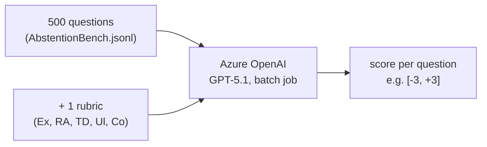

# Running the annotation script, start to finish

This is a step-by-step guide to running `scripts/annotate_AbsBench.py` — the
program that asks an Azure-hosted GPT-5.1 model to rate 500 benchmark
questions on 5 behavioural traits, and saves the result as five CSV files.

## What this script actually does



This repeats once per trait, so one run produces **5 CSV files**, landing in
`data/annotations/AbstentionBench/`.

---

## How the script works, step by step

You don't need to understand this section to follow Steps 1–7 further down —
it's here so you (or anyone at Microsoft) can see exactly what happens
internally, in plain language, without reading the code.

1. **Load the credentials.** The script reads your API key and endpoint from
   the `.env` file (Step 5 below).
2. **Load the "how to answer" instructions.** Reads `rubrics/presentation.txt`
   once. This is a fixed block of instructions, identical for every question
   and every trait — it's explained fully in "Anatomy of the prompt" below.
3. **Load the dataset.** Reads the questions file (see "The dataset" section
   below) into a table with one row per question.
4. **Assign an ID to every question.** Adds a column with values
   `AbstentionBench_0`, `AbstentionBench_1`, `AbstentionBench_2`, ... — one
   per row — so every question can be tracked all the way through to its
   final CSV row.
5. **Pick 500 questions at random.** Out of the full dataset, exactly 500 rows
   are sampled, using a fixed "seed" number (`random_state=42`). Using a fixed
   seed means the *same* 500 questions are picked every single time the script
   runs against this same dataset file — this is what makes the run
   reproducible instead of picking a different random set each time.
6. **For each of the 5 traits** (extraversion, risk aversion, delay of
   gratification, ultracrepidarianism, coopetition), one after another:
   1. Load that trait's rubric file (e.g. `rubrics/Ex_v1.md`) — a document
      that defines what scores from -3 to +3 mean for this specific trait,
      with worked examples for each level.
   2. Assemble one full prompt per question (500 of them) — see "Anatomy of
      the prompt" below for exactly what this contains. Nothing is sent to
      Azure yet at this point, it's only being prepared.
   3. Send all 500 prompts to Azure in one go, as a single **batch job**
      (this is simply Azure's term for "here are many requests, work through
      them in the background and tell me when you're done" — it's cheaper
      and more efficient than sending 500 separate requests one at a time).
      Azure immediately hands back a batch job ID and starts working through
      it behind the scenes.
   4. **Wait.** The script checks in with Azure every 60 seconds, asking "is
      this batch job done yet?". This is the part that can take anywhere
      from a few minutes to several hours (see "Step 6 — Run the script"
      further down).
   5. Once Azure reports the batch as complete, download all 500 answers.
   6. Read each answer's text and pull out the two numbers written between
      `<FINAL_RANGE>[ ... ]</FINAL_RANGE>` at the very end of it — this
      becomes that question's `lower_bound` and `upper_bound`.
   7. Save all 500 scored questions for this trait into one CSV file.
7. Move to the next trait and repeat step 6, until all 5 CSV files exist.

## Anatomy of the prompt sent to the model

For every single question, the block of text actually sent to the Azure model
is built by gluing **five pieces together, in this exact order, back to
back** (nothing extra is added in between):

1. **A short, fixed role instruction**, identical for every question and every trait:

   > You are an expert at analyzing questions for cognitive biases.

2. **A one-line introduction naming the trait**, ending in an opening `<rubric>` tag. The script fills in the trait name automatically — for extraversion, this reads:

   > The following is a rubric for determining the propensity of showing propensity towards extraversion:
   >
   > \<rubric\>

3. **The entire rubric file for that trait** (e.g. all of `rubrics/Ex_v1.md`) — several paragraphs defining what a score of -3, -2, -1, 0, +1, +2 or +3 means for this specific trait, each level with two or three worked examples. This is by far the longest piece of the prompt.

4. **The shared "how to answer" instructions**, read from `rubrics/presentation.txt`. This piece *starts* with the closing `</rubric>` tag (closing what piece 2 opened), then tells the model exactly how to reason about the question — working outward from 0 in both directions, one level at a time — and, critically, forces a strict output format at the very end:

   > The final line of your response must be:
   >
   > \<FINAL_RANGE\>[LB, UB]\</FINAL_RANGE\>
   >
   > Do not output any additional text after this line.
   >
   > Annotate the following task:

   This is *why* the script can reliably pull two numbers back out of the
   model's free-form written answer afterwards: the model isn't just hoping
   to guess the right format — it's explicitly told to end every single
   answer with something like `<FINAL_RANGE>[-2, +3]</FINAL_RANGE>`, and the
   script looks specifically for that exact pattern (a small piece of
   pattern-matching logic called a "regex").

5. **The question itself**, taken word-for-word from the dataset's `question`
   field — nothing added before or after it.

Schematically, the full prompt looks like this:

```
[role instruction][trait intro] <rubric>
[the entire rubric file for this trait]
</rubric>
[the shared answering instructions] Annotate the following task:[the question]
```

Concretely — for the extraversion trait, on the question "what is the
currency of japan?" — the real assembled prompt begins:

```
You are an expert at analyzing questions for cognitive biases.The following
is a rubric for determining the propensity of showing propensity towards
extraversion:

<rubric>
# EXTRAVERSION PROPENSITY

## Definition
The Extraversion Propensity is a scalar dimension from -3 or below ...
```

...continues through the entire rubric file, and ends with:

```
</rubric>
Your task is to determine the propensity range for a given question.
...
The final line of your response must be:

<FINAL_RANGE>[LB, UB]</FINAL_RANGE>

Do not output any additional text after this line.

Annotate the following task:what is the currency of japan?
```

(Yes, there's no space before the question starts — that's simply how the
pieces are joined together in the code. It doesn't confuse the model, but if
you ever read a raw prompt and it looks slightly squashed together at the
seams, that's why.)

## The dataset: format and required fields

The questions file must be a **`.jsonl` file** — this is *not* the same as a
normal `.json` file, and the difference matters:

- A normal `.json` file is one single structure, usually one big list wrapped
  in square brackets: `[ {...}, {...}, {...} ]`.
- A **`.jsonl`** ("JSON Lines") file has **no** wrapping brackets or commas
  between entries — instead, every line of the file is its own independent
  JSON object, one question per line.

A valid 3-line dataset file looks exactly like this:

```
{"question": "What is the capital of France?"}
{"question": "Is it ever okay to lie to protect someone's feelings?"}
{"question": "How many moons does Jupiter have?"}
```

**The only field this script reads is `question`** (plain text, in quotes).
Everything else is either generated automatically or ignored:

| Field | Required? | Notes |
|---|---|---|
| `question` | **Yes** | The text shown to the model. Must be a non-empty string, on every line. |
| `instance_id` | No — ignore it | The script generates its own IDs (`AbstentionBench_0`, `AbstentionBench_1`, ...) when it loads the file, overwriting anything already there. |
| anything else | No | The dataset you were given also happens to carry `reference_answers`, `should_abstain` and `metadata_json` columns (used by *other* scripts, not this one). Harmless to leave in, not required. |

A few practical requirements:

- The file must be saved as plain text with **UTF-8 encoding** (the default
  for basically every modern text editor).
- It must contain **at least 500 lines**, because the script always randomly
  samples exactly 500 of them (Step 6, "Pick 500 questions at random," in the
  section above). Fewer than 500 lines makes the script crash immediately.
- The file must live at `data/benchmarks/<name>/<name>.jsonl` — note that the
  **folder name and the file name must match each other**, and both must
  match the `ds = "AbstentionBench"` line near the top of the script. Swapping
  in a different dataset means renaming *both* to match, and asking a
  developer to update that one line — not something to attempt alone.

A common mistake to avoid — this is regular `.json`, **not** `.jsonl`, and
will make the script fail to read the file:

```
[
  {"question": "What is the capital of France?"},
  {"question": "How many moons does Jupiter have?"}
]
```

## The "source" field: which model actually answers

Inside the script, each question is annotated with:

```python
source = "gpt-5.1"
```

This isn't just a label — it's passed straight through to Azure as the
**exact name of the model to run**. And in Azure OpenAI, you can't simply ask
for "a GPT model" by its public name; whoever manages the Azure resource
first has to create a **deployment** — a specific, named, running instance of
a chosen model — inside the Azure Portal (or the newer Azure AI Foundry
portal), under **your Azure OpenAI resource → Model deployments**. The
`source` value in this script has to match that deployment's name *exactly*,
character for character.

Practically, this means:

- Running (or changing) this script requires someone with **access to the
  Azure Portal** for the `openaiazureprop` resource, to check or create a
  deployment with the matching name.
- If asked "which model does this call," the accurate answer is *"whatever
  model is currently deployed under the name `gpt-5.1` in the
  `openaiazureprop` Azure OpenAI resource"* — this may or may not be the same
  as a model literally named "GPT-5.1" by OpenAI; that's entirely determined
  by what was deployed in the Portal, not by this script.
- If the deployment name doesn't exist or was renamed/deleted, **every one**
  of that trait's 500 requests fails the same way, and shows up in the error
  file instead of producing scores.

---

## Before you start

Four things you need in hand before Step 1. If any of these is missing, stop
and ask Dani first.

- This folder, already on your computer (it contains a `scripts`, `src` and `rubrics` folder).
- Python installed on your computer, version 3.10 or newer (Step 2 checks this for you).
- An Azure OpenAI **API key** and **endpoint URL**.
- Roughly 15 minutes of setup time. Running the script itself can take from a few minutes up to several hours in the background — see Step 6.

> **⚠ About the API key.** A new one
> must be requested and placed only in the local `.env` file described in
> Step 5, which is never uploaded or shared (it's excluded via `.gitignore`).
> If you ever see a long random-looking string that looks like a password
> inside a script file, stop and flag it — it should never be there.

---

## Step 1 — Open the project folder in a terminal

Everything below is typed into a **terminal** (a text window for typing
commands — on Windows this is **PowerShell**). Always run commands from
inside this project folder, never from anywhere else.

**If you're using VS Code:** open this folder (`File → Open Folder…`), then
open the menu `Terminal → New Terminal`. A terminal panel appears at the
bottom, already pointed at the right folder — you're done, skip to Step 2.

**If you're using File Explorer instead:** navigate into this folder, click
once in the empty area of the address bar at the top, type `powershell` and
press Enter.

**Expect:** a dark or blue window with a blinking cursor, ending in something
like `PS C:\...\tutorial>`.

## Step 2 — Check that Python is installed

Type the following into the terminal and press Enter:

```
python --version
```

**Expect:** a line like `Python 3.12.8`. Any version 3.10 or higher is fine.

**If instead you see an error** such as `'python' is not recognized...`,
Python isn't installed. Go to `python.org/downloads`, download the installer,
and — this is the part people miss — **tick the box that says "Add
python.exe to PATH"** before clicking Install. Then close the terminal, open
a new one, and try this step again.

## Step 3 — Install the required packages

The script relies on a handful of published Python packages (for reading
data tables, talking to Azure, etc). Install them all in one go:

```
pip install -r requirements.txt
```

**Expect:** a few lines of text scrolling by, ending in something like
`Successfully installed ...`. This only needs to be done once (not every time
you run the script).

## Step 4 — Get the Azure OpenAI key and endpoint

| What | Looks like |
|---|---|
| API key | a long string of random letters/numbers |
| Endpoint | `https://openaiazureprop.openai.azure.com/` |

Have these two values ready — copy them somewhere temporary like Notepad —
before moving to the next step. **Do not** paste them into an email,
Slack/Teams message, or any shared document. Treat this key exactly like a
password.

## Step 5 — Put the key into the `.env` file

This folder has a file named `.env.example`. Make a copy of it in the same
folder and rename the copy to exactly `.env` (no `.example`, and note the
leading dot — in File Explorer you may need to tick "File name extensions"
under the View tab to rename it correctly).

Open `.env` with Notepad. You'll see:

```
AZURE_OPENAI_API_KEY=your-azure-openai-key-here
AZURE_OPENAI_ENDPOINT=https://your-resource-name.openai.azure.com/
```

Replace `your-azure-openai-key-here` with the key from Step 4 (keep
everything from `AZURE_OPENAI_API_KEY=` onward on one line, no spaces, no
quote marks). Replace the endpoint line with the URL from Step 4. Save the
file (Ctrl+S) and close Notepad.

> **Why a separate file?** Keeping secrets in `.env` instead of inside the
> script means this file is never uploaded anywhere (it's explicitly excluded
> via `.gitignore`). The script reads these two values automatically when it
> starts.

## Step 6 — Run the script

Back in the terminal from Step 1 (still inside this folder), type:

```
python scripts/annotate_AbsBench.py
```

**Expect:** text scrolling by such as `Annotation successfully sent in batch
form, batch id: ...`, then a long pause, then eventually `Batch successfully
completed. Parsing results...` — repeated 5 times, once per trait.

> **This step takes a while — that's normal.** The script sends 500
> questions × 5 traits = 2,500 requests to Azure as a background batch job,
> and checks in every 60 seconds to see if it's done. This can take anywhere
> from a few minutes to several hours depending on Azure's queue. Leave the
> terminal window open and let your computer stay awake; do not close it
> early. If it hasn't finished after 8 hours, the script stops itself with a
> timeout error.

## Step 7 — Find your results

Once it finishes, look inside:

```
data/annotations/AbstentionBench/
```

You'll find **5 new CSV files**, one per trait, named like:

```
ft_AbstentionBench_Ex_GPT-5.1_annotated2.csv   <- extraversion
ft_AbstentionBench_RA_GPT-5.1_annotated2.csv   <- risk aversion
ft_AbstentionBench_TD_GPT-5.1_annotated2.csv   <- delay of gratification
ft_AbstentionBench_Ul_GPT-5.1_annotated2.csv   <- ultracrepidarianism
ft_AbstentionBench_Co_GPT-5.1_annotated2.csv   <- coopetition
```

Double-click any of them to open in Excel. Done — that's the whole run.

---

## What's inside each CSV

Every row is one question, scored on one trait.

| Column | Meaning |
|---|---|
| `propensity` | Trait code for this file (e.g. `Ex` = extraversion) |
| `task_prompt` | The original benchmark question shown to the model |
| `custom_id` | Unique ID of the question, so results can be matched back to the source dataset |
| `lower_bound` / `upper_bound` | The model's scored range, e.g. -3 to +3 |
| `explanation` | The model's full written reasoning behind that score |

---

## Already verified without spending anything

Before handing this over, the pipeline was run end-to-end with `test_mock_pipeline.py`
— a stand-in for Azure that always answers "-3 to +3" instead of making a real
network call. It proves the code correctly builds the batch request, waits
for it, downloads the result, and writes a clean CSV, with **zero real API
calls or cost**. You can re-run this check yourself any time:

```
python test_mock_pipeline.py
```

Real rows produced by that mock run (trimmed for width):

| propensity | task_prompt | custom_id | lower | upper |
|---|---|---|---|---|
| Ex | what is the currency of japan? | AbstentionBench_24208 | -3 | 3 |
| Ex | I was at a cafe next to two people. Which person spoke more quietly? | AbstentionBench_5869 | -3 | 3 |

The real Azure model will return varied scores and reasoning, not a fixed
-3/+3 for every row — this only confirms the plumbing works.

---

## If something goes wrong

**The terminal says "Missing AZURE_OPENAI_API_KEY environment variable"**
The `.env` file wasn't created correctly, or still has the placeholder text.
Re-open Step 5 and check the file is named exactly `.env` (not
`.env.example`) and contains your real key with no extra spaces or quotes.

**The terminal says "ModuleNotFoundError: No module named '...'"**
Go back to Step 3 and run `pip install -r requirements.txt` again — a package
didn't install the first time.

**Can I close my laptop lid while it's running?**
No — sleeping/closing the laptop pauses the script. Keep it plugged in and
awake (adjust Windows power settings if it sleeps automatically) until Step 6
finishes.
